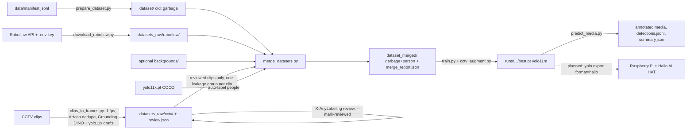

# PROJECT_STATE — Garbage Detection (garbage + person, CCTV)

_Last updated: 2026-11-20 · Version 0.3.3-dev · Last pushed state: `main` (0.3.2-dev commit, 2026-11-20; see git log)_

## 1. Project overview
- **Purpose:** detect garbage (and people) in CCTV frames, so we know whether garbage is present at a location and can later detect dumping events. The planned deployment is a Raspberry Pi 5 with an AI HAT (Hailo) and a camera.
- **Tech stack:** Python 3, Ultralytics YOLO11 (8.4.x), PyTorch (CUDA on a 6 GB GPU for training), Albumentations 2.0.8, OpenCV, Pillow, requests, PyYAML. No other services.
- **How to run:** see the README section "v2". In short: `./run.sh deps` → put the key in `.env` → copy `dataset/` →
  `./run.sh roboflow` → `./run.sh merge` → `./run.sh train` → `./run.sh evaluate` → `./run.sh predict <media>`.
- **Tests:** `.venv/bin/python -m unittest discover -s tests -t tests -v` (54 tests).

## 2. Features
| Feature | Status | Date |
|---|---|---|
| JSONL manifest → YOLO dataset download + audit | done | 2026-11-17 |
| CUDA training with 6 GB VRAM cap + per-epoch VRAM log | done | 2026-11-18 |
| Random test-split visualizer | done | 2026-11-17 |
| Roboflow human+trash dataset download (REST, `.env` key) | done. Verified against the live API: key valid, version 2 export link generated | 2026-11-19 |
| Clearer 401 errors (Roboflow reason, key source) | done | 2026-11-19 |
| Merge datasets → 2 classes (garbage, person) | done | 2026-11-19 |
| Auto-label people in old images (yolo11x, cached) | done | 2026-11-19 |
| Leakage control (Roboflow aug groups + dHash near-duplicates) | done | 2026-11-19 |
| Optional background (empty scene) images | done (no images supplied yet) | 2026-11-19 |
| CCTV-style training augmentation (4 levels) + preview | done | 2026-11-19 |
| YOLO11m default model | done | 2026-11-19 |
| Image/video/stream prediction + persistence alerts + image-level accuracy | done | 2026-11-19 |
| Train v2 model on GPU machine | planned (user) | — |
| Dataset preview with ground-truth boxes (`preview_dataset.py`) | done | 2026-11-20 |
| Restore old garbage labels from manifest (`restore_old_labels.py`) | done (run on local copy) | 2026-11-20 |
| Opt-in Roboflow down-sampling in merge (close-up / portrait / train cap) | done (not yet used in a merge) | 2026-11-20 |
| Live Pi camera demo on CPU (NCNN, `~/garbage_live/live.py` on the Pi, not in repo) | done (test only) | 2026-11-20 |
| CCTV frames pipeline from clips (Part B, `clips_to_frames.py`, `./run.sh cctv-frames`) | done: Grounding DINO drafts, CUDA auto, 1500-frame budget, box filters, review gate | 2026-11-20 |
| Merge reviewed CCTV frames (`merge_datasets.py --cctv`, automatic in `./run.sh merge`) | done (no reviewed clips yet) | 2026-11-20 |
| Automatic download of CCTV training clips (`./run.sh cctv-download`, `data/cctv_train_clips.txt`, 65 clips) | done (download tested on 2 clips + 1 invalid id) | 2026-11-20 |
| Near-duplicate CCTV frame removal (`dedupe_cctv.py`, preview then `--apply`, moves to `_duplicates/`) | done (preview run: 133 of 1511) | 2026-11-20 |
| CCTV data collection, about 1500 frames, plus human review in X-AnyLabeling | planned (user, on GPU machine) | — |
| Hailo export + Raspberry Pi inference service | planned | — |
| Per-camera ROI masks, day/night thresholds, dumping-event logic (person + new static garbage) | planned (proposed, not approved) | — |

## 3. Changelog
See `CHANGELOG.md`. The latest entry is 0.3.3-dev (2026-11-20): removal of near-duplicate CCTV frames. Before that, 0.3.2-dev (2026-11-20): automatic download of CCTV training clips. Before that, 0.3.1-dev (2026-11-20): Grounding DINO confidence 0.30, transformers in requirements, GPU runbook. Before that, 0.3.0-dev (2026-11-20): dataset preview, old-label restore, opt-in Roboflow down-sampling, CCTV frame drafting and merge. Before that, 0.2.1 (2026-11-19): Roboflow material class names map to garbage, and clearer 401 errors. Before that, 0.2.0 added the full v2 pipeline.

## 4. Architecture

- `run.sh` is the single entry point. `debug_log.py` is shared by all new scripts.
- Ultralytics applies CCTV degradations after mosaic/affine, and they change pixels only, so boxes are untouched. They are stored inside the checkpoint args.
- In video, an alert switches on only when garbage appears in `persist` of the last `window` sampled frames.
- CCTV frames are drafts until a human reviews them. `review.json` is the gate: `collect_cctv` merges only clips with `reviewed=true`. Splits are assigned per clip (md5 of the clip name), so frames of one video never cross splits.

## 5. Function reference
**scripts/debug_log.py**
- `enable(flag)`: turns debug output on. Side effect: changes a module-level flag. Returns None.
- `is_enabled()`: returns a bool.
- `dbg(func, msg)`: prints `[DEBUG][func] msg` to stderr when enabled.

**scripts/download_roboflow.py**
- `load_env_file(path) -> dict`: parses KEY=VALUE lines, ignoring comments and blank lines. Returns {} if the file is missing.
- `get_api_key(env_path) -> str`: reads the key from the environment first, then `.env`. Side effect: sets the module variable `KEY_SOURCE`. Raises SystemExit if the key is missing or still the placeholder.
- `mask(text, key) -> str`: replaces the key with `***`.
- `api_get(url, key) -> dict`: GET request with the key as a query parameter. Raises SystemExit with masked messages on network errors, 401/403, 404, other >=400 or non-JSON responses. A 401/403 message includes Roboflow's reason, `KEY_SOURCE`, and the key's length and last 3 characters.
- `resolve_version(ws, project, version, key) -> str`: turns "latest" into the highest version id. Raises SystemExit if no versions are found.
- `get_export_link(ws, project, version, fmt, key, poll_seconds, max_wait) -> str`: polls until `export.link` exists. Raises SystemExit on timeout.
- `download_file(link, dest, key) -> Path`: streams to `.part`, then renames atomically. Raises SystemExit on failure.
- `safe_extract(zip, out) -> int`: extracts and returns the file count. Raises SystemExit on a path that escapes `out`.
- `main(argv) -> int`: CLI. It is skipped if `output/data.yaml` exists, unless `--overwrite` is passed.

**scripts/merge_datasets.py**
- `load_names(root) -> list[str]`: reads names from data.yaml, as a list or a dict.
- `build_class_map(names, overrides) -> {src_id: 0|1|None}`: maps classes by keyword or override. Garbage keywords include plastic, metal, paper and glass. Raises SystemExit on unknown or ambiguous names.
- `find_split_dirs(root) -> {split: (images, labels)}`: supports both the Ultralytics and Roboflow layouts, and `valid` as an alias for `val`.
- `parse_label_file(path) -> (boxes, invalid_count)`: converts polygons to boxes and clips boxes to [0,1]. Invalid rows are dropped.
- `collect_cctv(root, overrides) -> (records, info)` (added 2026-11-20): returns records for frames whose clip (`<clip>_f######`) has `reviewed=true` in `root/review.json`. Sets `group='cctv:<clip>'` and returns info with the reviewed and not-reviewed clips, frames used and frames skipped. Raises SystemExit if review.json is missing.
- `main()` (changed 2026-11-20): `--cctv DIR` adds the CCTV records before leakage control. `merge_report.json` → `sources.cctv`.
- `collect_source(name, root, overrides) -> (records, names)`: builds one record per image with remapped boxes and a Roboflow group key. Raises SystemExit if there is no data.yaml or no images.
- `fix_group_leakage(records) -> int`: marks copies of one photo that sit outside its highest-priority split (test > val > train) as `drop`.
- `dhash(path) -> int|None`: 64-bit difference hash. Returns None if the image is unreadable.
- `fix_near_duplicates(records, max_distance, workers) -> Counter`: uses LSH banding. Drops cross-split duplicates (lower-priority split) and cross-source duplicates in the same split, and marks unreadable images.
- `autolabel_people(records, model, conf, imgsz, device, batch, cache_path) -> int`: appends class-1 boxes. Side effects: downloads the model and reads/writes the cache JSON. The cache is reset if the model, conf or imgsz change.
- `safe_name(text) -> str`: makes a filename safe.
- `filter_roboflow(records, closeup=None, portrait=None, cap_train=None, seed=0, source="rf") -> Counter`: marks live rf records as dropped.
  `closeup`: exactly one box with area w*h > closeup → `rf_closeup`. `portrait`: no garbage and exactly one person box with area > portrait → `rf_portrait`.
  `cap_train`: seeded shuffle of live rf train records, keeps the first N → `rf_cap` (val/test never capped). Equal-to-threshold is kept.
  Side effect: sets `drop` on records (nothing deleted). Returns drop counts. Raises ValueError if a fraction is not in (0, 1] or cap < 0 (main turns it into SystemExit).
- `write_dataset(records, out, workers) -> dict`: copies images, writes labels and returns per-split statistics.
- `parse_overrides(items) -> dict`: parses `name=garbage|person|drop`. Raises SystemExit on bad input.
- `main(argv) -> int`: CLI. Writes `data.yaml` and `merge_report.json`. Raises SystemExit if the output exists without `--overwrite`.

**scripts/cctv_augment.py**
- `TimestampOverlay(p)`: Albumentations ImageOnlyTransform. Draws a random date/time and camera label in a corner. It can be serialized, so it can be stored in checkpoints.
- `build_cctv_augmentations(level) -> list|None`: returns None for `off`; otherwise 10 transforms whose probabilities are scaled by 0.5/1.0/1.5 (capped at 0.95). Raises ValueError on an unknown level.
- `preview(src, out, level, n, seed) -> list[Path]`: writes original|augmented side-by-side images. Raises SystemExit if the folder has no images.
- `main(argv) -> int`: preview CLI.

**scripts/predict_media.py**
- `expand_sources(list) -> [(kind, path)]`: kind is image, video or stream. Accepts folders recursively, globs, rtsp/rtmp/http URLs and digits (webcam). Raises SystemExit if a source is missing or empty.
- `class_ids(names) -> (garbage_id, person_id|None)`: works with old 1-class models and 2-class models.
- `frame_detections(result, g, p) -> dict`: returns the boxes, the garbage count and max confidence, and the person count.
- `PersistenceAlert(persist, window).update(bool) -> 'start'|'end'|None`: sliding-window vote. Raises ValueError on invalid parameters.
- `run_image(...) -> dict`: predicts one image and saves the annotated image unless `--no-save`.
- `run_video(...) -> dict`: samples frames at `--sample-fps`, applies the persistence alert, writes `<stem>_pred.mp4`, and returns alert events in seconds.
- `image_accuracy(per_source, labels_dir) -> dict`: counts TP/FP/FN/TN for "garbage present" and returns precision, recall, F1 and accuracy.
- `main(argv) -> int`: CLI. Writes `detections.jsonl` and `summary.json`. Raises SystemExit if the model is missing.

**scripts/preview_dataset.py** (new 2026-11-20)
- `load_names(root) -> list`: class names from data.yaml (list or dict).
- `read_boxes(label_path) -> [(cls, cx, cy, w, h)]`: reads YOLO lines; polygons become boxes; missing file → [].
- `draw_one(job) -> (kind, counts)`: draws boxes on one image and saves it to `<out>/<split>/` or `<out>/<split>/empty_labels/`. kind is boxed, empty or unreadable.
- `main()`: CLI `--data --out --splits --workers`. Writes `summary.json`. Runs in a process pool on CPU.

**scripts/restore_old_labels.py** (new 2026-11-20)
- `safe_name(text)`: same rule as merge_datasets.safe_name, used to rebuild merged file names.
- `load_manifest(path) -> {stem: [lines]}`: YOLO lines per manifest image (boxes with w or h <= 0 skipped).
- `backup(labels_dir) -> Path`: copies the folder to `labels_backup_<timestamp>/`.
- `restore_merged(root, manifest) -> stats`: rewrites `old_*.txt` = manifest garbage boxes + existing non-class-0 lines.
- `restore_old_dataset(root, manifest) -> stats`: rewrites `dataset/labels/<split>` for images present and writes `data.yaml`.
- `main()`: CLI `--manifest --merged --old --skip-old`.

**scripts/train.py**
- `parse_batch(value, on_gpu, cap_gb, total_gb)`: unchanged.
- `main()`: now also accepts `--cctv-aug/--patience/--debug` and passes `augmentations=` to `model.train`.

**scripts/clips_to_frames.py** (new, 2026-11-20)
- `parse_assign(items) -> {clip: split}`: parses `CLIP=train|val|test`. Raises ValueError on bad input.
- `hamming(a, b) -> int`: number of differing bits between two hashes.
- `extract_frames(video, fps, tmp_dir) -> [{frame, time_s, path}]`: saves every round(src_fps/fps)-th frame as JPEG. Raises ValueError for fps<=0, SystemExit if the video can't be opened.
- `dedupe_frames(frames, max_distance) -> (kept, dropped)`: keeps a frame only if its dHash differs from the last kept frame by more than `max_distance` bits. Side effect: deletes dropped duplicate files. Unreadable frames are dropped.
- `to_yolo_lines(result, cls_out) -> [str]`: Ultralytics boxes to normalised YOLO lines with class `cls_out`.
- `draft_labels(paths, person_model, garbage_model, person_conf, garbage_conf, imgsz, device) -> {path: [lines]}`: garbage (class 0) lines first, then person (class 1, COCO class 0 only).
- `write_clip(frames, labels, out, split) -> int`: moves frames to `out/images/<split>/` and writes labels to `out/labels/<split>/`.
- `update_review(out, clip, entry)`: adds or replaces a clip in `out/review.json`; keeps `reviewed=true` if already set.
- `main(argv) -> int`: CLI. Writes `data.yaml`; skips clips already in review.json unless `--overwrite`. Raises SystemExit on bad `--assign` or missing videos. `--garbage-backend yolo-world|gdino` chooses the garbage drafter.
- `gdino_prompt(prompts) -> str`: turns a list of phrases into the Grounding DINO text, lowercase with each phrase ending in '.'.
- `_Boxes(xywhn)`: a minimal stand-in for Ultralytics `result.boxes` (`.xywhn.tolist()`, `len()`).
- `filter_garbage_boxes(lines, max_area, nested_frac) -> (lines, {'too_big','nested'})`: drops garbage drafts covering more than `max_area` of the image, and drafts more than `nested_frac` inside a LARGER garbage draft. Person lines are unchanged. 0 disables each rule.
- `_parse_line(line)`, `_inside_frac(a, b)`: helpers. `_inside_frac` returns the fraction of box a's area that lies inside box b.
- `default_garbage_conf(backend) -> float`: returns 0.30 for gdino and 0.15 for yolo-world. Raises ValueError for an unknown backend.
- `auto_split(clip, val_pct, test_pct) -> split`: stable split from the md5 of the clip name. Raises ValueError on bad percentages.
- `expand_videos(paths) -> [Path]`: keeps files and searches folders recursively for videos.
- `mark_reviewed(out, clips) -> [str]`: sets `reviewed=true` for the given clips (or `['all']`). Raises SystemExit if review.json is missing or a clip is unknown.
- `main()` (changed): `--device auto` resolves through `gpu_utils.resolve_device`. Garbage confidence defaults to 0.40 (gdino) or 0.15 (yolo-world). Also adds `--max-frames`, `--val-pct`, `--test-pct`, `--max-garbage-area`, `--nested-frac` and `--mark-reviewed`, and writes `classes.txt`.
- `GroundingDinoDetector(model_id, prompts, text_threshold, nms_iou, device)`: loads the HF model (network download on first use). `predict(path, conf)` returns `[result]` with normalised boxes. It clips boxes to the image and merges overlaps with class-agnostic NMS. It uses CUDA only when a device other than cpu is given and CUDA is available.

**`scripts/dedupe_cctv.py`** (new, 0.3.3-dev)
- `dhash256(path) -> bool[256] | None`: 16x16 difference hash. Returns None for an unreadable image.
- `read_classes(data) -> [str]`: reads `classes.txt`. Raises SystemExit if it is missing.
- `load_boxes(img, label_txt, classes) -> (boxes, checked)`: returns normalised corner boxes. It prefers the X-AnyLabeling JSON (pixel rectangles, labels outside `classes` ignored) and falls back to the YOLO txt. `checked` is the X-AnyLabeling checked flag.
- `iou(a, b)`, `same_boxes(A, B, iou_min) -> bool`: same count, and every box has a same-class partner with IoU at or above `iou_min`.
- `find_duplicates(data, split, classes, max_distance, iou_min) -> [{kept, dup, distance}]`: compares frames only within their clip, in frame order, against frames already kept. Checked frames are never duplicates. Read-only.
- `write_preview(pairs, out_dir, split) -> [Path]`: writes contact sheets (KEEP on the left, MOVE on the right, 10 pairs per sheet).
- `move_duplicates(data, split, pairs) -> int`: moves `.jpg`, `.json` and `.txt` to `<data>/_duplicates/<same relative path>` and appends to `moved.jsonl`. Raises SystemExit rather than overwrite.
- `main()`: CLI with `--data`, `--splits`, `--max-distance 40`, `--iou 0.7`, `--preview`, `--apply` and `--debug`.

**Unchanged existing modules**
- `prepare_dataset.py`: `safe_filename`, `read_manifest`, `normalize_box`, `build_records`, `make_session`, `download_one`, `write_labels`, `main`.
- `audit_dataset.py`: `main`.
- `gpu_utils.py`: `resolve_device`, `cuda_index`, `configure_cuda`, `vram_snapshot`, `add_vram_tracker`.
- `test_visualizer.py`: `get_test_directory`, `main`.

## 6. Threats and security notes
**Handled**
- The Roboflow key lives only in `.env` (git-ignored, mode 600) or an environment variable, and is masked in every error message.
- Zip-slip protection when extracting the export.
- Downloads go to `.part` first and are renamed atomically.
- Dataset leakage between train/val/test is controlled.
- Unknown class names stop the merge instead of being silently mislabeled.
- The public test clips are not committed.

**Open**
1. The Roboflow key was shared in chat, so regenerate it.
2. The repo is **public** and contains `data/manifest.jsonl` with signed image URLs that stay valid until 2026-11-20 08:00 UTC.
2. Auto-labelled people are model output, not human-checked, so spot-check them.
3. The license of the Roboflow fork is unverified (the parent project is CC BY 4.0), so check it before commercial use.
4. Privacy: frames contain people and faces. Plan face blurring and a retention limit for stored alerts before deployment.
5. RTSP credentials passed on the command line are visible in the process list and shell history. Use env vars or a config file on the Pi.
6. Public datasets can contain poisoned or incorrect labels. Review `merge_report.json` and samples.
7. No CCTV images from the actual target cameras exist yet, which is the largest accuracy risk.

## 7. Decisions log
| Date | Decision | Why |
|---|---|---|
| 2026-11-19 | Two classes `garbage`, `person` | Teach the model that people are not garbage; enables dumping logic later |
| 2026-11-19 | Auto-label people in old images with yolo11x (conf 0.40) | Unlabeled people would teach "person = background" |
| 2026-11-19 | Add `albumentations` (2.0.8, MIT) | CCTV degradations; Ultralytics' built-ins run at 0–1% and the library was not installed |
| 2026-11-19 | Model `yolo11m` (not YOLO26) | User asked for best accuracy in bad conditions. Fits 6 GB with AMP. YOLO11 keeps ~96% mAP50 after Hailo INT8 vs ~93% for YOLO26, with on-chip NMS (Ultralytics Hailo docs) |
| 2026-11-19 | Roboflow via REST + `.env`, no Roboflow SDK | Avoid another dependency; user pastes key |
| 2026-11-19 | Tests with stdlib `unittest` | No new test dependency |
| 2026-11-19 | Map Plastic/Metal/Paper/Glass → garbage by keyword | Goal is "garbage present?"; avoids manual --class-map |
| 2026-11-19 | 401 errors show Roboflow reason + key source + last 3 chars | Faster diagnosis. The key stays masked; 3 characters are enough to tell keys apart |
| 2026-11-20 | Restore old labels from `data/manifest.jsonl` instead of re-labelling | Manifest had the boxes; the 0-byte files came from a broken copy |
| 2026-11-20 | Roboflow down-sampling is opt-in flags, default off | Keeps current merges reproducible; user approved approach A |
| 2026-11-20 | Priority: more CCTV images with person + garbage, accurately labelled | Only 3% of train images have both classes; YouTube test showed garbage misses on CCTV |
| 2026-11-20 | Part B approach approved: clips → 1 fps → dHash dedupe → draft labels → human review → merge as `cctv`; whole clip per split | Avoids frame leakage between splits; drafts speed up labelling |
| 2026-11-20 | YOLO-World (`yolov8m-worldv2`) for garbage drafts, not Grounding DINO | CPU-friendly, inside Ultralytics. Smoke test: it misses garbage piles (see pending) |
| 2026-11-20 | Smoke-test split: MU5JriIfo5k → train, PEyhUwGBrnQ → val | User: test the full flow on 2 clips first |
| 2026-11-20 | Smoke-test Grounding DINO (tiny, `transformers`) as the garbage drafter; output goes to `datasets_raw/cctv_gdino` | YOLO-World missed piles. A separate folder keeps the YOLO-World output for comparison |
| 2026-11-20 | Don't pin `clip`/`transformers` in requirements.txt | User decision |
| 2026-11-20 | Grounding DINO drafts accepted ("most of it is good"). Garbage confidence 0.40; drop garbage boxes > 80% of the image and boxes > 80% nested in a larger one | Smoke test: piles found in 30/30 frames; false positives were scooters, a rickshaw and nested boxes |
| 2026-11-20 | Workflow: Grounding DINO drafts, then human review in X-AnyLabeling (YOLO import/export with `classes.txt`), then `--mark-reviewed`, then merge | Drafts are not ground truth; the review gate stops unreviewed labels reaching training |
| 2026-11-20 | Grounding DINO garbage confidence 0.30 (not 0.40) | Re-check: 0.40 cut PEyh drafts from 38 to 1. Real litter scored ~0.34, the same as vehicle false positives, so vehicles are removed during review |
| 2026-11-20 | Pin `transformers>=5.23,<6` in requirements.txt (reverses the earlier decision not to pin) | User request; needed on the GPU machine |
| 2026-11-20 | Training clips come from a committed YouTube id list; downloads are video-only mp4 at 720p or less via yt-dlp (added to requirements) | Block A failed because nothing downloaded clips. Video-only avoids an ffmpeg merge, and audio is not needed |
| 2026-11-20 | Training clip list must never overlap test/eval clips (enforced by a test) | Keeps the CCTV evaluation honest |
| 2026-11-20 | Labelling rule: garbage bins/dumpsters are NOT garbage. Box only garbage on the ground, overflowing or being dumped | Otherwise every street bin would trigger an alert. Grounding DINO boxes bins, so they are removed during review |
| 2026-11-20 | CCTV duplicate rule: same clip AND dHash distance of 40 or less (of 256 bits) AND same boxes (IoU 0.7). Duplicates are moved to `_duplicates/`, never deleted; checked frames are never moved | Preview sheets showed that a hash-only rule removes frames where only the person moved. The user approved building it |
| 2026-11-20 | Target about 1500 CCTV frames; run on the GPU machine with CUDA (`--device auto`) | CPU here takes about 12 s per Grounding DINO frame (about 5 h for 1500); the GPU is expected to take minutes |

## 8. Pending items
- Run `python scripts/dedupe_cctv.py --data datasets_raw/cctv --apply` after the user approves the preview (close X-AnyLabeling first). The same step goes into the GPU runbook before review.
- GPU machine: follow `docs/GPU_RUNBOOK.md` step by step. Block A originally failed ("no usable videos") because no clips were downloaded; fixed in 0.3.2-dev with `./run.sh cctv-download`.
- Smoke test of the final settings on 3 new clips (2026-11-20, 41 frames): the drafts need heavy review. Wrong boxes were a logo/title card, a scooter, a gate, shelving and a wheelie bin; a person was missed at night. Estimate 3–4 h to review 1500 frames.
- Some of the 65 YouTube ids may become unavailable over time. The download only warns about these.
- Part B code is done (2026-11-20). Next, on the GPU machine:
  1. Collect about 60 CCTV clips.
  2. `./run.sh cctv-frames <folder>`.
  3. Review in X-AnyLabeling.
  4. `--mark-reviewed`.
  5. Run `restore_old_labels.py`, then `./run.sh merge` and retrain.
  6. Smoke-test training first (Phase 7).
- Smoke outputs on this PC: `datasets_raw/cctv_smoke_yoloworld` (YOLO-World, moved from `datasets_raw/cctv`) and `datasets_raw/cctv_gdino` (Grounding DINO at conf 0.30, no filters). Neither is reviewed and neither is in the repo.
- Earlier Part B notes (historical):
  - Person drafts (yolo11x) are good.
  - Garbage drafts (YOLO-World) are poor: they miss piles and box a sign or a board. Tuning prompts and using the `x` model did not help.
  - Open question: what should produce the garbage drafts? Options: retrain on the restored labels and use our model, Grounding DINO on the GPU machine, or manual boxes.
  - PEyhUwGBrnQ contains an inserted ad (non-CCTV frames). Clips need trimming or frame review.
  - Merge integration (`cctv` source in `merge_datasets.py`) is not built yet.
- `clip` (YOLO-World dependency) is installed in the venv but not pinned in `requirements.txt`.
- Hailo HEF compile needs the Hailo Dataflow Compiler (x86 Linux, Hailo developer account). It is not on this PC or on the Pi. The Pi demo currently runs on CPU (~1.3 FPS).
- The training machine's `dataset/` had 0-byte label files, and 2395 images there were unreadable (dropped by the merge, including all old val images). Copy this machine's restored `dataset_merged/labels` or fix the source and re-merge before retraining.
- 177 images in local `dataset/` have names that don't match the manifest, so their labels are still empty.
- Label quality: some old labels are wrong (e.g. a full frame of autumn leaves labelled garbage) and box style is mixed (whole pile vs per item).
- Dry run of Roboflow down-sampling on current train (6206 rf images): close-up>0.5 drops 937, portrait>0.4 drops 366, both drop 1066 (5140 remain). Not applied yet.
- On the GPU machine, `./run.sh roboflow` returned 401 even though the key is valid. The likely cause is an exported shell variable overriding `.env`, or a `.env` formatting problem; the new error message will show which. The key was pasted into chat, so **regenerate it** after downloading.
- Roboflow dataset facts: 9,928 images, CC BY 4.0, version 2. Classes: People 8,010, Plastic 5,672, Waste 3,280, Metal 1,543, Paper 1,190, Glass 805 (boxes are per item, while the old dataset boxes piles).
- Copy `dataset/` to the training machine. The download links expire on 2026-11-20 08:00 UTC, so back the folder up.
- Train on the GPU machine and compare against the baseline in `tests/cctv_test_clips.txt`.
- The old dataset includes studio close-ups of bottles on white backgrounds that don't look like CCTV. Consider filtering them out (needs approval).
- Collect frames from the real deployment cameras (labelled + empty) and add them through `--backgrounds` or as a CCTV test split.
- Hailo export (`format=hailo`, needs Hailo DFC on Linux x86_64) and a Pi inference service: next task.
- Proposed, not approved: per-camera ROI masks, day/night thresholds, SAHI tiling, dumping-event logic, an RF-DETR comparison.
- Known quirk: Ultralytics nests output as `runs/detect/runs/detect/<name>`. Scripts already point there.
