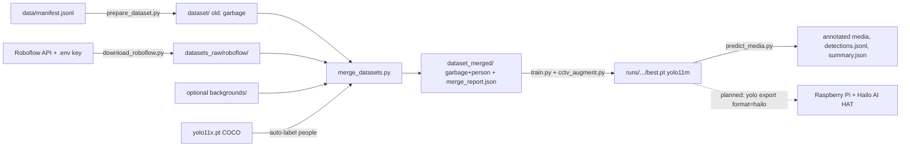

# PROJECT_STATE — Garbage Detection (garbage + person, CCTV)

_Last updated: 2026-11-19 · Version 0.2.0 · Last pushed state: `main` at 72089bc (fast-forward merge of `feat/garbage-person-cctv`), pushed 2026-11-19_

## 1. Project overview
- **Purpose:** detect garbage (and people) in CCTV frames, so we know whether garbage is present at a location and can later detect dumping events. The planned deployment is a Raspberry Pi 5 with an AI HAT (Hailo) and a camera.
- **Tech stack:** Python 3, Ultralytics YOLO11 (8.4.x), PyTorch (CUDA on a 6 GB GPU for training), Albumentations 2.0.8, OpenCV, Pillow, requests, PyYAML. No other services.
- **How to run:** see the README section "v2". In short: `./run.sh deps` → put the key in `.env` → copy `dataset/` →
  `./run.sh roboflow` → `./run.sh merge` → `./run.sh train` → `./run.sh evaluate` → `./run.sh predict <media>`.
- **Tests:** `.venv/bin/python -m unittest discover -s tests -t tests -v` (50 tests).

## 2. Features
| Feature | Status | Date |
|---|---|---|
| JSONL manifest → YOLO dataset download + audit | done | 2026-11-17 |
| CUDA training with 6 GB VRAM cap + per-epoch VRAM log | done | 2026-11-18 |
| Random test-split visualizer | done | 2026-11-17 |
| Roboflow human+trash dataset download (REST, `.env` key) | done (untested against live API — needs key) | 2026-11-19 |
| Merge datasets → 2 classes (garbage, person) | done | 2026-11-19 |
| Auto-label people in old images (yolo11x, cached) | done | 2026-11-19 |
| Leakage control (Roboflow aug groups + dHash near-duplicates) | done | 2026-11-19 |
| Optional background (empty scene) images | done (no images supplied yet) | 2026-11-19 |
| CCTV-style training augmentation (4 levels) + preview | done | 2026-11-19 |
| YOLO11m default model | done | 2026-11-19 |
| Image/video/stream prediction + persistence alerts + image-level accuracy | done | 2026-11-19 |
| Train v2 model on GPU machine | planned (user) | — |
| Hailo export + Raspberry Pi inference service | planned | — |
| Per-camera ROI masks, day/night thresholds, dumping-event logic (person + new static garbage) | planned (proposed, not approved) | — |

## 3. Changelog
See `CHANGELOG.md`. The latest entry is 0.2.0 (2026-11-19): Roboflow download, dataset merge, CCTV augmentation, YOLO11m, media prediction, and tests.

## 4. Architecture

- `run.sh` is the single entry point. `debug_log.py` is shared by all new scripts.
- Ultralytics applies CCTV degradations after mosaic/affine, and they change pixels only, so boxes are untouched. They are stored inside the checkpoint args.
- In video, an alert switches on only when garbage appears in `persist` of the last `window` sampled frames.

## 5. Function reference
**scripts/debug_log.py**
- `enable(flag)`: turns debug output on. Side effect: changes a module-level flag. Returns None.
- `is_enabled()`: returns a bool.
- `dbg(func, msg)`: prints `[DEBUG][func] msg` to stderr when enabled.

**scripts/download_roboflow.py**
- `load_env_file(path) -> dict`: parses KEY=VALUE lines, ignoring comments and blank lines. Returns {} if the file is missing.
- `get_api_key(env_path) -> str`: reads the key from the environment first, then `.env`. Raises SystemExit if it is missing or still the placeholder.
- `mask(text, key) -> str`: replaces the key with `***`.
- `api_get(url, key) -> dict`: GET request with the key as a query parameter. Raises SystemExit with masked messages on network errors, 401/403, 404, other >=400 or non-JSON responses.
- `resolve_version(ws, project, version, key) -> str`: turns "latest" into the highest version id. Raises SystemExit if no versions are found.
- `get_export_link(ws, project, version, fmt, key, poll_seconds, max_wait) -> str`: polls until `export.link` exists. Raises SystemExit on timeout.
- `download_file(link, dest, key) -> Path`: streams to `.part`, then renames atomically. Raises SystemExit on failure.
- `safe_extract(zip, out) -> int`: extracts and returns the file count. Raises SystemExit on a path that escapes `out`.
- `main(argv) -> int`: CLI. It is skipped if `output/data.yaml` exists, unless `--overwrite` is passed.

**scripts/merge_datasets.py**
- `load_names(root) -> list[str]`: reads names from data.yaml, as a list or a dict.
- `build_class_map(names, overrides) -> {src_id: 0|1|None}`: maps classes by keyword or override. Raises SystemExit on unknown or ambiguous names.
- `find_split_dirs(root) -> {split: (images, labels)}`: supports both the Ultralytics and Roboflow layouts, and `valid` as an alias for `val`.
- `parse_label_file(path) -> (boxes, invalid_count)`: converts polygons to boxes and clips boxes to [0,1]. Invalid rows are dropped.
- `collect_source(name, root, overrides) -> (records, names)`: builds one record per image with remapped boxes and a Roboflow group key. Raises SystemExit if there is no data.yaml or no images.
- `fix_group_leakage(records) -> int`: marks copies of one photo that sit outside its highest-priority split (test > val > train) as `drop`.
- `dhash(path) -> int|None`: 64-bit difference hash. Returns None if the image is unreadable.
- `fix_near_duplicates(records, max_distance, workers) -> Counter`: uses LSH banding. Drops cross-split duplicates (lower-priority split) and cross-source duplicates in the same split, and marks unreadable images.
- `autolabel_people(records, model, conf, imgsz, device, batch, cache_path) -> int`: appends class-1 boxes. Side effects: downloads the model and reads/writes the cache JSON. The cache is reset if the model, conf or imgsz change.
- `safe_name(text) -> str`: makes a filename safe.
- `write_dataset(records, out, workers) -> dict`: copies images, writes labels and returns per-split statistics.
- `parse_overrides(items) -> dict`: parses `name=garbage|person|drop`. Raises SystemExit on bad input.
- `main(argv) -> int`: CLI. Writes `data.yaml` and `merge_report.json`. Raises SystemExit if the output exists without `--overwrite`.

**scripts/cctv_augment.py**
- `TimestampOverlay(p)`: Albumentations ImageOnlyTransform. Draws a random date/time and camera label in a corner. It can be serialized, so it can be stored in checkpoints.
- `build_cctv_augmentations(level) -> list|None`: returns None for `off`; otherwise 10 transforms whose probabilities are scaled by 0.5/1.0/1.5 (capped at 0.95). Raises ValueError on an unknown level.
- `preview(src, out, level, n, seed) -> list[Path]`: writes original|augmented side-by-side images. Raises SystemExit if the folder has no images.
- `main(argv) -> int`: preview CLI.

**scripts/predict_media.py**
- `expand_sources(list) -> [(kind, path)]`: kind is image, video or stream. Accepts folders recursively, globs, rtsp/rtmp/http URLs and digits (webcam). Raises SystemExit if a source is missing or empty.
- `class_ids(names) -> (garbage_id, person_id|None)`: works with old 1-class models and 2-class models.
- `frame_detections(result, g, p) -> dict`: returns the boxes, the garbage count and max confidence, and the person count.
- `PersistenceAlert(persist, window).update(bool) -> 'start'|'end'|None`: sliding-window vote. Raises ValueError on invalid parameters.
- `run_image(...) -> dict`: predicts one image and saves the annotated image unless `--no-save`.
- `run_video(...) -> dict`: samples frames at `--sample-fps`, applies the persistence alert, writes `<stem>_pred.mp4`, and returns alert events in seconds.
- `image_accuracy(per_source, labels_dir) -> dict`: counts TP/FP/FN/TN for "garbage present" and returns precision, recall, F1 and accuracy.
- `main(argv) -> int`: CLI. Writes `detections.jsonl` and `summary.json`. Raises SystemExit if the model is missing.

**scripts/train.py**
- `parse_batch(value, on_gpu, cap_gb, total_gb)`: unchanged.
- `main()`: now also accepts `--cctv-aug/--patience/--debug` and passes `augmentations=` to `model.train`.

**Unchanged existing modules**
- `prepare_dataset.py`: `safe_filename`, `read_manifest`, `normalize_box`, `build_records`, `make_session`, `download_one`, `write_labels`, `main`.
- `audit_dataset.py`: `main`.
- `gpu_utils.py`: `resolve_device`, `cuda_index`, `configure_cuda`, `vram_snapshot`, `add_vram_tracker`.
- `test_visualizer.py`: `get_test_directory`, `main`.

## 6. Threats and security notes
**Handled**
- The Roboflow key lives only in `.env` (git-ignored, mode 600) or an environment variable, and is masked in every error message.
- Zip-slip protection when extracting the export.
- Downloads go to `.part` first and are renamed atomically.
- Dataset leakage between train/val/test is controlled.
- Unknown class names stop the merge instead of being silently mislabeled.
- The public test clips are not committed.

**Open**
1. The repo is **public** and contains `data/manifest.jsonl` with signed image URLs that stay valid until 2026-11-20 08:00 UTC.
2. Auto-labelled people are model output, not human-checked, so spot-check them.
3. The license of the Roboflow fork is unverified (the parent project is CC BY 4.0), so check it before commercial use.
4. Privacy: frames contain people and faces. Plan face blurring and a retention limit for stored alerts before deployment.
5. RTSP credentials passed on the command line are visible in the process list and shell history. Use env vars or a config file on the Pi.
6. Public datasets can contain poisoned or incorrect labels. Review `merge_report.json` and samples.
7. No CCTV images from the actual target cameras exist yet, which is the largest accuracy risk.

## 7. Decisions log
| Date | Decision | Why |
|---|---|---|
| 2026-11-19 | Two classes `garbage`, `person` | Teach the model that people are not garbage; enables dumping logic later |
| 2026-11-19 | Auto-label people in old images with yolo11x (conf 0.40) | Unlabeled people would teach "person = background" |
| 2026-11-19 | Add `albumentations` (2.0.8, MIT) | CCTV degradations; Ultralytics' built-ins run at 0–1% and the library was not installed |
| 2026-11-19 | Model `yolo11m` (not YOLO26) | User asked for best accuracy in bad conditions. Fits 6 GB with AMP. YOLO11 keeps ~96% mAP50 after Hailo INT8 vs ~93% for YOLO26, with on-chip NMS (Ultralytics Hailo docs) |
| 2026-11-19 | Roboflow via REST + `.env`, no Roboflow SDK | Avoid another dependency; user pastes key |
| 2026-11-19 | Tests with stdlib `unittest` | No new test dependency |

## 8. Pending items
- The user pastes `ROBOFLOW_API_KEY` into `.env`. Run `./run.sh roboflow` and check the class names it reports.
- Copy `dataset/` to the training machine. The download links expire on 2026-11-20 08:00 UTC, so back the folder up.
- Train on the GPU machine and compare against the baseline in `tests/cctv_test_clips.txt`.
- The old dataset includes studio close-ups of bottles on white backgrounds that don't look like CCTV. Consider filtering them out (needs approval).
- Collect frames from the real deployment cameras (labelled + empty) and add them through `--backgrounds` or as a CCTV test split.
- Hailo export (`format=hailo`, needs Hailo DFC on Linux x86_64) and a Pi inference service: next task.
- Proposed, not approved: per-camera ROI masks, day/night thresholds, SAHI tiling, dumping-event logic, an RF-DETR comparison.
- Known quirk: Ultralytics nests output as `runs/detect/runs/detect/<name>`. Scripts already point there.
